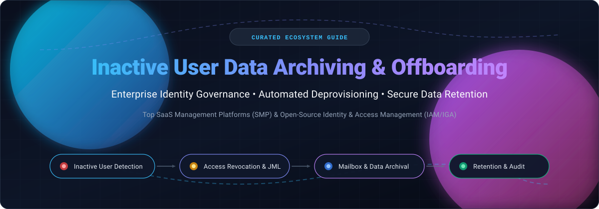

<div align="center">



# ⚡ Awesome Inactive User Data Archiving & Offboarding 🚀

<a href="https://github.com/ishandutta2007/Awesome-Awesome-Awesome"></a><a href="https://discord.gg/jc4xtF58Ve"></a>
[](https://github.com/ishandutta2007/Awesome-Awesome-Awesome)
[](http://makeapullrequest.com)
[](https://github.com/ishandutta2007/Awesome-Inactive-User-Data-Archiving-Offboarding)
[](http://creativecommons.org/publicdomain/zero/1.0/)
<a href="https://github.com/ishandutta2007"></a>

**A curated index of enterprise SaaS platforms, open-source Identity Governance & Administration (IGA) tools, and automation scripts for inactive user account discovery, joiner-mover-leaver (JML) deprovisioning workflows, mailbox archiving, and statutory data retention.** 📦🔒

</div>

---

## 📑 Table of Contents

- [🔍 Overview & Architecture](#-overview--architecture)
- [📊 Sector Overview & Market Dynamics](#-sector-overview--market-dynamics)
- [☁️ SaaS / Hosted Platforms](#️-saas--hosted-platforms)
- [💻 Open-Source GitHub Projects](#-open-source-github-projects)
- [⚙️ Key Workflows & Implementation Patterns](#️-key-workflows--implementation-patterns)
- [🤝 How to Contribute](#-how-to-contribute)
- [⭐ Star History](#-star-history)
- [💖 Support & Sponsorship](#-support--sponsorship)
- [⚖️ Disclaimer & Compliance](#️-disclaimer--compliance)

---

## 🔍 Overview & Architecture

Managing departed and inactive users is a cornerstone of enterprise security, compliance (SOC 2, ISO 27001, HIPAA, GDPR), and SaaS cost optimization. Orphaned accounts, dormant licenses, and unassigned data introduce severe security attack vectors and generate unnecessary subscription overhead. 🛡️📉

```
       [ Trigger: HRIS / Inactivity Detection ]
                          │
                          ▼
            [ Identity Governance (IdP/IGA) ]
       (Revoke OAuth Tokens, Suspend Logins, Reset MFA)
                          │
       ┌──────────────────┴──────────────────┐
       ▼                                     ▼
[ SaaS Apps Deprovisioning ]       [ Data & Mailbox Archiving ]
(SCIM 2.0 / API Reassignment)      (Exchange Inactive Mailbox /
                                   Google Vault / Long-Term S3)
                          │
                          ▼
              [ Statutory Retention Hold ]
              (Audit Logging & Compliance)
```

This repository covers both **commercial SaaS operations platforms** and **open-source identity components** to build reliable, compliant offboarding and archiving pipelines. 🔐✨

---

## 📊 Sector Overview & Market Dynamics

The global **SaaS Management Platform (SMP)** market is estimated at **$4.6B - $4.8B (2025)** and projected to exceed **$9.6B by 2026** (growing at ~15.4% CAGR), while the **Identity Governance and Administration (IGA)** market is valued at **~$8.4B - $9.3B (2025)** and reaching **~$10.7B by 2026** (~14.9% CAGR). 📈🌐

The sector displays a **moderately fragmented** structure in mid-market SaaS operations (where specialized players like BetterCloud, Torii, and Lumos compete on application connector depth and autonomous access reviews), contrasted with high concentration in enterprise foundational identity and collaboration suites (dominated by Okta, Microsoft Entra/Purview, and Google Cloud). 🏢🏆

---

## ☁️ SaaS / Hosted Platforms

Below is a comparison of major commercial SaaS platforms providing inactive user detection, automated offboarding, and data archiving. The table is **sorted by Company Size (Market Cap / Valuation / Revenue, descending)**. 💰🏷️

| SaaS Product | Description / Offboarding Capability | Company Size (Valuation / Revenue) | Starting Pricing (Specific Tier) | Free Tier Limits / Free Trial Details |
| :--- | :--- | :--- | :--- | :--- |
| **[Microsoft 365 Inactive Mailbox](https://www.microsoft.com/en-us/microsoft-365)** | Exchange Online / Purview compliance feature to preserve departed-user mailboxes indefinitely under Litigation Hold or Retention Policy with zero ongoing license seat cost. 📧 | **~$3.1 Trillion** market cap (Microsoft Corporation; FY2024 Revenue: $245.1B) | **$8.00 / user / month** (*Exchange Online Plan 2* standalone; required to place mailbox on hold before deletion; $0 ongoing once account is deleted and converted) | **30-day free trial** of Microsoft 365 Business Premium / E3 (capped at 25 trial user licenses). Inactive mailboxes store retained email indefinitely for $0. |
| **[Google Workspace Inactive User Policy](https://workspace.google.com/)** | Centralized admin directory controls, automated user suspension policies, license re-allocation, and Google Vault retention holds for departed employees. 📁 | **~$2.1 Trillion** market cap (Alphabet Inc.; FY2024 Revenue: $350B) | **$7.00 / user / month** (*Business Starter* annual commitment; $8.40/user/mo flexible; Google Vault retention available in *Business Plus* at $22.00/user/mo) | **14-day free trial** across standard business plans (limited to a maximum of 10 test user accounts with full admin features). |
| **[Okta Lifecycle Management](https://www.okta.com/)** | Enterprise Identity Provider with HR-driven automated provisioning, deprovisioning (SCIM), role-based access removal, and Okta Workflows automation. 🔑 | **~$31.5 Billion** market cap (NASDAQ: OKTA; TTM Revenue: ~$3.0B) | **$14.00 / user / month** (*Core Essentials Tier*, billed annually with $1,500 annual tenant minimum commitment) | **30-day free trial** of Okta Workforce Identity Cloud (strictly limited to 10 active test users, 1 admin account, and up to 5 active Okta Workflows). |
| **[Rippling Offboarding](https://www.rippling.com/)** | Unified HR & IT cloud platform executing instantaneous offboarding: triggers payroll termination, revokes SaaS accounts, and manages device collection/wipe. 💼 | **$16.8 Billion** valuation (Series F; ARR: $500M+) | **$8.00 / employee / month** (Rippling Unity core directory; typical operational IT + HR bundles scale from $15.00 to $35.00+ PEPM, plus $35/mo base platform fee) | **No public free tier or self-serve trial** (Evaluation requires tailored sales consultation and pilot demo; promotional 6-month trial only for select early-stage venture startups). |
| **[SailPoint Lifecycle Management](https://www.sailpoint.com/)** | Enterprise Identity Governance and Administration (IGA) with automated Joiner-Mover-Leaver (JML) workflows, separation of duty (SoD) policies, and deep access revocation. 🛡️ | **~$6.9 Billion** valuation (acquired by Thoma Bravo; ARR: $1.2B+) | **$6.00 / identity / month** (estimated baseline for *Identity Security Cloud Business*; contracts enforce minimum ~$75,000/year annual commitment) | **No self-serve free trial or free tier** (Requires customized enterprise Proof of Concept / sandbox scoped with systems integration partners). |
| **[Druva Inactive User Retention](https://www.druva.com/)** | 100% SaaS cloud data resiliency platform protecting and archiving Microsoft 365, Google Workspace, and endpoint data for departed personnel. 💾 | **$2.0 Billion** valuation (Unicorn; Series H; SaaS ARR: $200M+) | **$8.00 / user / month** (*Microsoft 365 / Google Workspace Backup & Governance* baseline tier; annual contract) | **30-day free trial** (Full platform trial access, capped at evaluating up to 100 test user accounts or 1 TB of protected cloud storage). |
| **[BambooHR Offboarding](https://www.bamboohr.com/)** | Mid-market HRIS with structured employee offboarding task lists, stakeholder notifications, automated IT ticket dispatch, and asset reclaim tracking. 👥 | **~$1.0+ Billion** valuation (Private equity; Annual Revenue: ~$300M+) | **$10.00 / employee / month** (*Core Plan*; flat rate of $250/month minimum for companies with 25 or fewer employees) | **7-day free trial** (Instant access with sample demo dataset; full access to offboarding checklists and workflows without requiring a credit card). |
| **[Lumos](https://www.lumos.com/)** | Autonomous identity governance and SaaS management platform for automated app discovery, Shadow IT monitoring, access reviews, and JIT deprovisioning. 🔦 | **$175 Million** valuation (Series B; Total Funding: $65M) | **~$10.00 / user / month** (Standard deployment benchmark; contracts structured annually with entry ACV benchmarks starting ~$12,000 to $36,000/year) | **No public self-serve free trial** (Provides free interactive guided security & shadow IT risk assessments and custom scoped POC sandbox pilots via sales). |
| **[BetterCloud](https://www.bettercloud.com/)** | Multi-SaaS operations platform automating cross-app employee deprovisioning, Google Workspace/M365 license reclamation, and cloud file transfer. 🔄 | **~$60 Million+** annual revenue (Backed by Warburg Pincus, Vista; Total Funding: $130M+) | **$3.00 - $6.00 / user / month** (Starting baseline scope for *Workspace Automation/Discovery*; full *Pro/Complete* multi-SaaS suites require annual contracts) | **Free tier available**: *Spend Optimization Basic* ($0/month, limited to basic license visibility). Standalone **21-day free trial** available for File Governance. |
| **[Torii](https://www.toriihq.com/)** | SaaS Management Platform (SMP) mapping Shadow IT, tracking license utilization, and automating complex offboarding trees across thousands of apps. ⛩️ | **~$21 Million** annual revenue (Series B; Total Funding: $65M) | **$2.50 / employee / month** (Starting baseline tier for discovery and inventory; full workflow offboarding tiers require custom annual enterprise contracts) | **No self-serve free trial** (Offers free automated SaaS discovery audits and guided interactive platform sandboxes via sales demo). |

---

## 💻 Open-Source GitHub Projects

Open-source identity, access, and directory management projects provide full transparent control over identity lifecycles, user deactivation, and data archiving pipelines without commercial vendor lock-in. 🔓🚀

The table below is **sorted by GitHub Stars (descending)**. Every repository star badge links directly to its live stargazers page. ⭐✨

| Repository | GitHub Stars Badge | Primary Language / License | Core Focus & Offboarding / Archiving Features |
| :--- | :--- | :--- | :--- |
| **[Keycloak](https://github.com/keycloak/keycloak)** | [](https://github.com/keycloak/keycloak/stargazers) | Java <br> `Apache-2.0` | Leading open-source Identity & Access Management (IAM). Provides robust Admin REST APIs, event listener SPIs, and user federation (LDAP/AD) to trigger immediate user disablement, credential revocation, and downstream webhooks upon offboarding. 🗝️ |
| **[Authentik](https://github.com/goauthentik/authentik)** | [](https://github.com/goauthentik/authentik/stargazers) | Python / Go <br> `GPL-3.0` | Modern, modular open-source Identity Provider. Features customizable event-driven execution flows, stage bindings, and SCIM provider integrations to deprovision accounts, terminate active sessions, and execute cleanup scripts upon employee termination. 🛡️ |
| **[Zitadel](https://github.com/zitadel/zitadel)** | [](https://github.com/zitadel/zitadel/stargazers) | Go <br> `Apache-2.0` | Cloud-native identity infrastructure with built-in multi-tenancy and audit trails. Supports granular user state transitions (`ACTIVE`, `INACTIVE`, `LOCKED`, `DELETED`) via gRPC and REST APIs for zero-trust lifecycle management. ⚡ |
| **[SuperTokens Core](https://github.com/supertokens/supertokens-core)** | [](https://github.com/supertokens/supertokens-core/stargazers) | Java / TypeScript <br> `Apache-2.0` | Open-source alternative to Auth0/AWS Cognito. Provides instant session invalidation, JWT blacklisting, and admin account deactivation APIs to immediately sever inactive user connections across all active devices. 🎟️ |
| **[Casdoor](https://github.com/casdoor/casdoor)** | [](https://github.com/casdoor/casdoor/stargazers) | Go / JavaScript <br> `Apache-2.0` | UI-first IAM platform with comprehensive SCIM 2.0 protocol support, LDAP sync, and third-party SaaS connectors (Google Workspace, Microsoft Entra ID). Automates user status toggling and account deprovisioning synchronizations. 🚪 |
| **[Ory Kratos](https://github.com/ory/kratos)** | [](https://github.com/ory/kratos/stargazers) | Go <br> `Apache-2.0` | Headless, cloud-native identity management service. Features explicit identity states (`active` vs. `inactive`), session revocation APIs, and webhook orchestrations to integrate offboarding events with long-term cold storage pipelines. 📜 |
| **[Kanidm](https://github.com/kanidm/kanidm)** | [](https://github.com/kanidm/kanidm/stargazers) | Rust <br> `MPL-2.0` | High-performance, memory-safe identity management and directory server. Implements strict account lifecycle controls, credential locking, RADIUS/OAuth2 revocation, and immutable audit logs. 🦀 |
| **[Ory Polis (formerly Jackson)](https://github.com/ory/polis)** | [](https://github.com/ory/polis/stargazers) | TypeScript <br> `Apache-2.0` | Enterprise SSO and Directory Sync gateway. Natively implements the SCIM 2.0 protocol for automated real-time user provisioning and de-provisioning from enterprise IdPs (Okta, Entra ID, OneLogin) directly into SaaS applications. 🔄 |
| **[FreeIPA](https://github.com/freeipa/freeipa)** | [](https://github.com/freeipa/freeipa/stargazers) | C / Python <br> `GPL-3.0` | Centralized identity, policy, and audit solution for Linux/Unix networks (389 Directory Server, MIT Kerberos). Supports user account expiration, host-based access control (HBAC) revocation, and automated home-directory archiving. 🐧 |
| **[Janssen Project](https://github.com/JanssenProject/jans)** | [](https://github.com/JanssenProject/jans/stargazers) | Java / Python <br> `Apache-2.0` | Linux Foundation high-performance IAM suite (evolution of Gluu Server). Includes Agama low-code identity orchestration for visual joiner-mover-leaver workflow pipelines and SCIM inbound/outbound sync. 🌐 |
| **[midPoint (Evolveum)](https://github.com/Evolveum/midpoint)** | [](https://github.com/Evolveum/midpoint/stargazers) | Java <br> `EUPL-1.2` | The premier open-source Identity Governance and Administration (IGA) system. Full JML engine handling roles, entitlements, segregation of duties, automated connector deprovisioning, and legal hold data preservation policies. 🏛️ |
| **[Apache Syncope](https://github.com/apache/syncope)** | [](https://github.com/apache/syncope/stargazers) | Java <br> `Apache-2.0` | Enterprise identity management system designed for provisioning, reconciliation, role management, and asynchronous lifecycle workflow execution across diverse internal and external directories. 🪶 |
| **[DeviceOffboardingManager](https://github.com/ugurkocde/DeviceOffboardingManager)** | [](https://github.com/ugurkocde/DeviceOffboardingManager/stargazers) | PowerShell <br> `MIT` | PowerShell GUI utility for managing and offboarding hardware endpoints across Microsoft Intune, Windows Autopilot, and Microsoft Entra ID. Streamlines device wiping, license release, and asset deregistration during employee exits. 💻 |
| **[Elimity SCIM](https://github.com/elimity-com/scim)** | [](https://github.com/elimity-com/scim/stargazers) | Go <br> `Apache-2.0` | Production-grade Go implementation of the RFC 7643 and RFC 7644 SCIM v2 specifications. Used to construct custom microservices that ingest standard identity deprovisioning payloads from enterprise IdPs. 📋 |
| **[PSAutomator](https://github.com/EvotecIT/PSAutomator)** | [](https://github.com/EvotecIT/PSAutomator/stargazers) | PowerShell <br> `MIT` | Enterprise PowerShell framework for onboarding and offboarding automation across on-premises Active Directory, Exchange Server, and cloud directory infrastructure. Handles permission stripping, folder backup, and mailbox holds. 🤖 |

---

## ⚙️ Key Workflows & Implementation Patterns

### 1. Inactive Account Detection Strategy 🔍
- **Signal Correlation:** Inactive accounts are best identified by correlating multiple data points rather than last-login timestamps alone:
  - Identity Provider last interactive authentication timestamp (e.g., Okta/Entra ID).
  - HRIS status (Leave of Absence vs. Active vs. Notice Period).
  - SaaS app activity via SCIM or OAuth token refresh logs.
- **Automated Grace Periods:** Move accounts from `Active` → `Staged Inactive` (warn user via Slack/Email) → `Suspended` (after 30-90 days of non-activity) → `Archived/Deleted`. ⏳

### 2. Zero-License Exchange / M365 Mailbox Archiving Pattern 📧
1. Apply **Litigation Hold** or **Purview Retention Policy** to user mailbox (requires Exchange Online Plan 2 or M365 E3/E5).
2. Delete the user account in Microsoft Entra ID / M365 Admin Center.
3. The mailbox transforms into an **Inactive Mailbox** retained indefinitely for legal eDiscovery ($0 license cost).
4. Reassign the liberated Microsoft license to an active employee. 💸

### 3. Open-Source Self-Hosted Pipeline Pattern 🛠️
- **IGA Engine**: Deploy **midPoint** as the central identity governor connecting HR data (via CSV/database).
- **Directory Sync**: Connect midPoint via **SCIM 2.0** (using `elimity-com/scim` or `ory/polis`) to downstream microservices.
- **Offboarding Dispatch**: When an HR exit event fires, trigger midPoint reconciliation:
  - Disable account in **Keycloak** / **Authentik**.
  - Invalidate all active OAuth/JWT tokens.
  - Trigger PowerShell / bash tasks to dump home directory to AWS S3 Glacier or MinIO.
  - Revoke group memberships and remove SSH/Kerberos credentials via **FreeIPA**.

---

## 🤝 How to Contribute

Contributions are welcome! Please follow these steps to propose new SaaS tools, open-source projects, or architecture guides: 🌟

1. Fork this repository. 🍴
2. Create your feature branch (`git checkout -b feature/add-new-tool`). 🌿
3. Add the project to the appropriate section:
   - For **SaaS platforms**: Include product name, URL, valuation/revenue metric, specific starting price, and exact free tier/trial limits in the table format.
   - For **Open-Source projects**: Include repository name, direct GitHub link, stargazers badge (`style=social&color=white`), license, and specific offboarding capabilities. Ensure it is sorted by star count.
4. Commit your changes (`git commit -m 'Add ToolName to offboarding guide'`). 📝
5. Push to the branch (`git push origin feature/add-new-tool`) and open a Pull Request. 🚀

---

##  Star History
[](https://www.star-history.com/#ishandutta2007/Awesome-Inactive-User-Data-Archiving-Offboarding&type=date&legend=top-left)

---

## 💖 Support & Sponsorship

Thank you for visiting and supporting this ecosystem initiative! 🙏 If you find this curated directory helpful for your identity security architecture, cloud operations, or compliance posture, please consider supporting the project:

- ⭐ **Star this repository** to help others discover it.
- 🍴 **Fork and contribute** updates or additional offboarding tooling.
- 📢 **Share with your network** on LinkedIn, Twitter/X, Reddit, or team Slack channels.
- ☕ **Buy a coffee & sponsor**: If this project has saved your team research time or licensing budget, you can support ongoing maintenance via the [GitHub Sponsor Dashboard](https://github.com/sponsors/ishandutta2007). Every sponsorship is deeply appreciated! ❤️

---

## ⚖️ Disclaimer & Compliance

- This repository is a community-curated research directory and does not constitute formal legal, human resources, or regulatory compliance advice. ⚠️
- Employee offboarding, mailbox inspection, and data retention are subject to international privacy frameworks (e.g., GDPR Article 17 "Right to be Forgotten", CCPA, HIPAA, and national labor laws). Always consult corporate legal counsel and data protection officers when configuring retention schedules and deprovisioning scripts. 📜

---

<div align="center">

**Star ⭐ this repository if you find it helpful for identity management and IT operations!** 🌟

</div>
